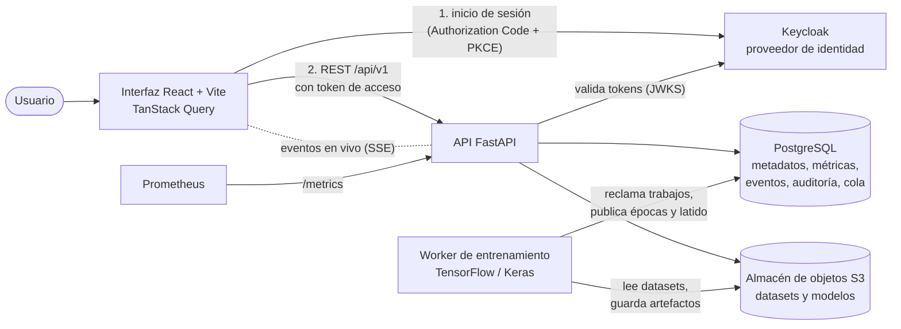
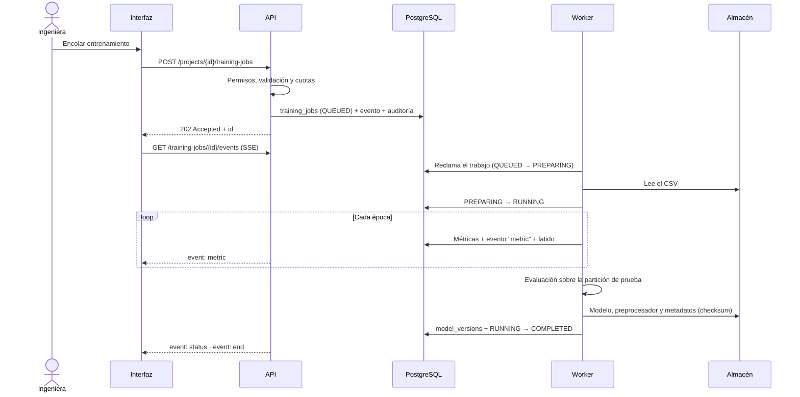
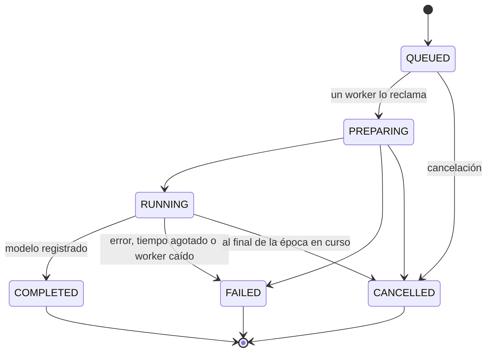

# Documento de arquitectura · NeuroLab Enterprise

Entregable del §17 del Documento Maestro: arquitectura, diagrama de componentes, roles, flujos y decisiones técnicas. El modelo de datos está en [modelo-de-datos.md](modelo-de-datos.md) y los contratos de la API en [../api/README.md](../api/README.md).

## 1. Objetivo y alcance

NeuroLab Enterprise es una plataforma web donde un equipo diseña, entrena, evalúa, versiona y aprueba redes neuronales con TensorFlow/Keras para resolver un problema de negocio (§2). Lleva a un sistema real las operaciones de la Semana 11 del curso PIAD-427 (§3):

| Operación de la Semana 11 | Dónde se cumple |
|---|---|
| Definir la red neuronal y su importancia | M03 Fundamentos: conceptos, ciclo de aprendizaje, glosario y ejemplo guiado |
| Describir su estructura: neuronas, capas, conexiones y activaciones | M04 Diseñador: editor de capas, grafo y validación de formas |
| Identificar tipos: Feedforward, RNN, CNN y GAN | M04: selector de familia con capas permitidas por familia |
| Crear una red con TensorFlow/Keras | M06 Entrenamientos: el worker compila y entrena el modelo |

**MVP (§18):** se cumple con la familia Feedforward. RNN, CNN y GAN se pueden diseñar y validar, pero todavía no entrenar. Se habilitan con `NEUROLAB_TRAINING_FAMILIES` a medida que tengan sus propias pruebas.

## 2. Roles y permisos (§4.2, §11)

Cada usuario tiene un **rol global**, y en cada proyecto del que es miembro, un **rol de proyecto**. Los permisos los decide siempre la API; la interfaz solo oculta los botones que no corresponden.

| Rol global | Para qué sirve |
|---|---|
| Administrador | Gestiona usuarios, roles, límites, políticas y auditoría global. Puede actuar en cualquier proyecto |
| Responsable de proyecto | Crea proyectos y administra su equipo y sus modelos |
| Ingeniero/analista de IA | Diseña arquitecturas, carga datasets, entrena y evalúa |
| Revisor | Consulta resultados, compara ejecuciones y aprueba versiones |
| Lector | Solo lectura de los proyectos y reportes autorizados |

Matriz por rol de proyecto (`app/modules/permissions.py`):

| Acción | owner | engineer | reviewer | reader |
|---|:-:|:-:|:-:|:-:|
| Ver el proyecto, sus datos y resultados | ✓ | ✓ | ✓ | ✓ |
| Editar el proyecto y gestionar miembros | ✓ | | | |
| Escribir documentación | ✓ | ✓ | | |
| Crear arquitecturas y cargar datasets | ✓ | ✓ | | |
| Eliminar datasets | ✓ | | | |
| Lanzar y cancelar entrenamientos | ✓ | ✓ | | |
| Revisar y aprobar modelos | ✓ | | ✓ | |
| Retirar modelos | ✓ | | | |
| Descargar modelos y exportar reportes | ✓ | ✓ | ✓ | |
| Consultar la auditoría del proyecto | ✓ | | ✓ | |

Pueden crear proyectos los roles globales administrador, responsable de proyecto e ingeniero. Quien no es miembro de un proyecto recibe **404** en lugar de 403: así no puede saber que el proyecto existe (protección contra acceso horizontal).

## 3. Flujo principal (§4.3) como historias de usuario

| # | Historia | Criterio de aceptación verificado |
|---|---|---|
| 1 | Como responsable, creo un proyecto y describo el problema | El proyecto aparece solo para sus miembros (`test_access.py`) |
| 2 | Como ingeniera, elijo la familia de red | Solo se ofrecen las capas válidas para esa familia (`test_architecture.py`) |
| 3 | Como ingeniera, defino entradas, capas, unidades, activaciones y salida | La API rechaza formas incompatibles y el conteo de parámetros coincide con Keras |
| 4 | Como ingeniera, elijo el dataset y los parámetros | Se valida el CSV, la columna objetivo y los límites vigentes (`test_datasets.py`) |
| 5 | Como ingeniera, envío el trabajo a la cola | Responde 202 al instante; nunca se entrena dentro de la petición HTTP |
| 6 | Como equipo, veo el progreso en vivo | Las épocas llegan por SSE sin recargar; al reconectar se recupera lo pendiente |
| 7 | Como revisora, evalúo, comparo, apruebo y exporto | Las versiones son inmutables y cada paso queda auditado (`test_training_flow.py`) |

## 4. Componentes (§5)

| Componente | Responsabilidad | Código |
|---|---|---|
| Interfaz web | Pantallas M01–M10, formularios validados, gráficas y el constructor visual. Nunca entrena ni guarda secretos | `apps/web` |
| API | REST versionado, autenticación, RBAC por proyecto, validaciones, límites de tasa y cuota, auditoría y canal SSE | `services/api/app` |
| Cola de trabajos | La propia tabla `training_jobs`. El worker reclama con un `UPDATE` condicional, así dos workers nunca toman el mismo trabajo | `workers/training/main.py` |
| Worker | Construye el modelo desde la configuración validada, entrena, evalúa, registra la versión y aplica la cancelación cooperativa | `workers/training` |
| PostgreSQL | Fuente de verdad: usuarios, proyectos, configuraciones, estado de cada trabajo, métricas por época, eventos y auditoría | `infra/migrations` (Alembic) |
| Almacén de objetos | Archivos CSV y paquetes de modelo (`.keras`, preprocesador `.pkl`, `metadata.json`). La base guarda solo la clave y el checksum | `app/core/storage.py` |
| Keycloak | Identidad y contraseñas, política de contraseñas y bloqueo por fuerza bruta. Los roles siguen en NeuroLab | `infra/keycloak` |
| Prometheus | Métricas de peticiones, latencia, límites de tasa, cola, modelos y workers | `infra/monitoring` |

## 5. Ciclo de un entrenamiento

### Estados del trabajo (RN-02, §10)

- Los estados finales no cambian. Reintentar un trabajo `FAILED` o `CANCELLED` crea uno nuevo enlazado al original (`retry_of_id`).
- La cancelación es una solicitud: el worker la aplica al terminar la época en curso y registra el motivo (RN-05).

### Estados de una versión de modelo (RN-04)

`DRAFT` (borrador) → `REVIEWED` (revisado) → `APPROVED` (aprobado). Desde cualquiera de ellos se puede pasar a `RETIRED` (retirado). Los artefactos nunca se sobrescriben: un nuevo entrenamiento crea una versión nueva (`v2`, `v3`…).

## 6. Seguridad (§11)

| Requisito | Implementación |
|---|---|
| Proveedor de identidad seguro | Keycloak con OIDC. La API valida tokens RS256 por JWKS (emisor, audiencia `neurolab-api` y expiración) y enlaza cada cuenta con su usuario por `sub`. En producción no arranca sin OIDC |
| RBAC y pertenencia | Matriz de la sección 2, comprobada en cada consulta y acción |
| Validación de entradas | Esquemas Pydantic en cada endpoint. La arquitectura y el CSV se vuelven a validar en el servidor |
| Secretos | Solo en `.env` o en variables del servidor; el bundle de React no contiene ninguno |
| Límites de tasa y cuotas | Peticiones por minuto y usuario, intentos de inicio de sesión por IP, tamaño de carga, épocas, duración, concurrencia por usuario y proyecto, y almacenamiento. Todos editables en M10 |
| Auditoría | Inicio, cancelación y reintento de trabajos, cambios de permisos y de rol, exportaciones, cambios de estado de modelos, descargas e inicios de sesión |
| Respaldos y retención | Respaldo con manifiesto y checksums, más prueba de restauración. La retención de auditoría, métricas y artefactos retirados la aplica el worker cada hora |
| Aislamiento de workers | El entrenamiento corre en otro proceso; nunca se ejecuta código ni notebooks aportados por usuarios |
| Logs | JSON estructurado que redacta tokens, contraseñas y claves |
| Cifrado en tránsito | **Pendiente (fase 6):** hoy funciona en HTTP local |

## 7. Requisitos no funcionales (§12)

| Área | Criterio | Cómo se cumple |
|---|---|---|
| Usabilidad | Crear un proyecto y configurar una arquitectura por pasos guiados | Asistentes en M02 y M04, con validación en vivo |
| Tiempo real | El estado y las métricas aparecen sin recargar; al reconectar se recupera el estado | SSE con `Last-Event-ID`, sobre eventos persistidos |
| Trazabilidad | Cada ejecución se puede consultar tras cerrar sesión y volver a entrar | Todo vive en PostgreSQL (`test_recovery.py`) |
| Seguridad | Nadie lee ni cancela trabajos de proyectos ajenos | 404 a no miembros (`test_foreign_user_cannot_read_or_cancel_job`) |
| Confiabilidad | Errores con mensaje controlado y traza técnica protegida | `status_reason` para el usuario y `error_detail` solo para administración |
| Mantenibilidad | Límites claros entre frontend, API, workers y persistencia | Estructura del §13; el worker no importa código de la interfaz |
| Pruebas | Unitarias, de integración y E2E | 102 pruebas de API en CI con PostgreSQL y S3, más el flujo E2E en navegador (Playwright) (ver [../operations/guia-operativa.md](../operations/guia-operativa.md#10-pruebas)) |

## 8. Decisiones donde el documento no especifica

| Decisión | Motivo |
|---|---|
| SSE en lugar de WebSocket | El canal solo va del servidor al navegador; SSE reconecta solo y reanuda con `Last-Event-ID` |
| Cola sobre la tabla `training_jobs` | Evita otro servicio (Redis o RabbitMQ). El reclamo condicional garantiza la exclusividad y el estado ya está persistido |
| Latido en un hilo propio cada 5 s | Una época larga no hace que se crea caído a un worker vivo; si el proceso muere, otro worker cierra el trabajo a los 120 s |
| Solo datasets CSV | Formato tabular universal y fácil de validar sin ejecutar nada. Otros formatos llegarán con las familias CNN y RNN |
| Keycloak como proveedor de identidad | Código abierto, local, con OIDC estándar; se puede cambiar por otro proveedor OIDC sin tocar la API |
| SeaweedFS como S3 en Docker y CI | MinIO dejó de publicar su imagen comunitaria; la API habla S3 estándar y funciona con cualquier proveedor |
| Métricas de regresión R², RMSE y MAE | El documento pide "evaluación final" sin fijar métricas; estas se leen en las unidades del objetivo |
| Errores de no miembro como 404 | No revelar la existencia de recursos ajenos |
