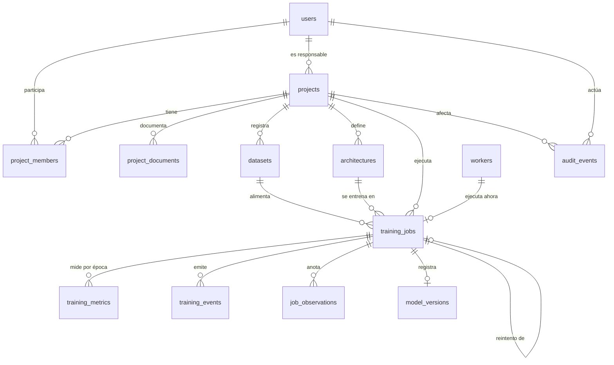

# Modelo de datos · NeuroLab Enterprise

Entregable del §17. Extiende el modelo inicial del §8 del Documento Maestro. El esquema real vive en `services/api/app/repositories/models.py` y se crea con las migraciones de Alembic en `infra/migrations/versions` (0001 esquema inicial, 0002 bloqueo de cuentas, 0003 enlace con el proveedor de identidad).

## Diagrama de entidades



## Entidades

| Tabla | Propósito | Campos clave |
|---|---|---|
| `users` | Identidad de aplicación, enlazada con el proveedor de identidad (§8) | `id`, `email`, `display_name`, `role` (rol global), `status` (ACTIVE, INVITED, SUSPENDED, LOCKED), `external_subject` (`sub` de Keycloak, único), `failed_logins`, `last_access_at` |
| `projects` | Espacio de trabajo de un problema de IA | `id`, `name`, `description`, `family`, `status` (DRAFT, ACTIVE, ARCHIVED), `owner_id`, `tags` |
| `project_members` | Acceso colaborativo por proyecto | (`project_id`, `user_id`) como clave, `role` (owner, engineer, reviewer, reader), `added_at` |
| `project_documents` | Documentación y contexto del proyecto | `project_id`, `title`, `body`, `author_id`, `updated_at` |
| `datasets` | Metadatos de cada versión de dataset; el archivo vive en el almacén de objetos | `name`, `version`, `storage_key`, `checksum` (SHA-256), `rows`, `columns`, `split` (entrenamiento, validación y prueba), `privacy`, `license`, `status`, `deleted_at` (borrado lógico) |
| `architectures` | Configuración validada de capas y parámetros | `name`, `family`, `version`, `config_json` (capas), `summary_json` (formas y parámetros), `justification` |
| `training_jobs` | Estado y ciclo de vida del trabajo; también hace de cola | `status`, `priority`, `progress`, `epoch`, `params_json` (épocas, lote, optimizador, tasa, semilla y tarea), `target_column`, `code_version`, `cancel_requested`, `status_reason`, `error_detail` (solo administración), `worker_id`, `heartbeat_at`, `retry_of_id`, `queued_at`, `started_at`, `ended_at` |
| `training_metrics` | Métricas por época | `job_id`, `epoch`, `metric_name`, `metric_value`, `recorded_at` |
| `training_events` | Bitácora persistida que alimenta el canal SSE | `id` (secuencial, sirve como `Last-Event-ID`), `job_id`, `type` (status, metric, log), `payload` |
| `model_versions` | Artefactos inmutables y trazables (RN-04) | `name`, `version`, `storage_key`, `checksum`, `status` (DRAFT, REVIEWED, APPROVED, RETIRED), `metrics_json` (métricas de prueba), `metadata_json` (dataset, parámetros, columnas, clases, historial de revisión). Un trabajo registra como máximo una versión |
| `job_observations` | Limitaciones, observaciones y riesgos registrados en M07 | `kind` (LIMITATION, OBSERVATION, RISK), `title`, `body`, `reviewed` |
| `audit_events` | Trazabilidad de acciones relevantes (§11) | `actor_id`, `project_id`, `action`, `target_type`, `target_id`, `metadata_json`, `ip`, `created_at` |
| `settings` | Límites y políticas editables en M10 | `key` (limits, security), `value` |
| `workers` | Workers conocidos y su latido | `id`, `hostname`, `pid`, `status` (IDLE, BUSY, OFFLINE), `current_job_id`, `last_seen_at` |

## Almacén de objetos

La base guarda solo la clave (`storage_key`) y el checksum; los archivos grandes nunca van en filas (§5).

| Clave | Contenido |
|---|---|
| `uploads/<proyecto>/<dataset>.csv` | Archivo original validado |
| `models/<proyecto>/<arquitectura>/v<N>/model.keras` | Pesos y grafo de Keras |
| `models/<proyecto>/<arquitectura>/v<N>/preprocessor.pkl` | Imputación, escalado, codificación y columnas de entrada |
| `models/<proyecto>/<arquitectura>/v<N>/metadata.json` | Dataset, parámetros, versión de Keras, columnas y clases |

Si un registro se interrumpe y deja objetos en `v<N>`, la versión siguiente salta ese número: nunca se sobrescriben objetos existentes.

## Retención (§11)

El worker aplica cada hora los plazos de M10:

| Dato | Plazo por defecto |
|---|---|
| Eventos de auditoría | 365 días |
| Métricas por época | 365 días |
| Artefactos de modelos retirados | 730 días |

## Cambios de esquema

```
cd services\api
..\..\venv\Scripts\python.exe -m alembic revision --autogenerate -m "descripcion"
```

La API aplica las migraciones pendientes al arrancar. La CI ejecuta `alembic check` para comprobar que el código y las migraciones no se separen.
